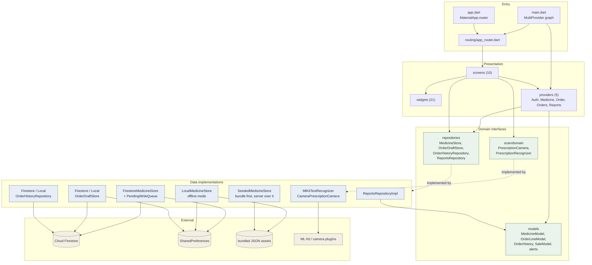
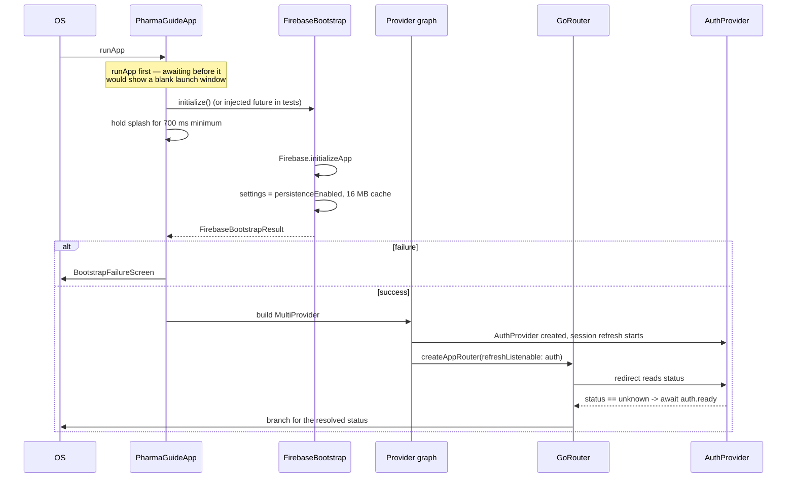
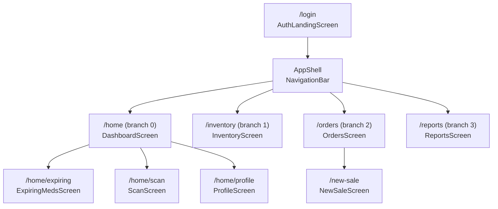
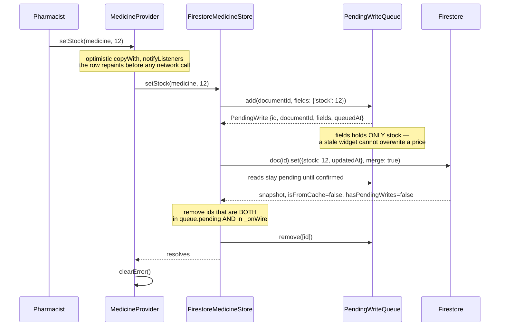
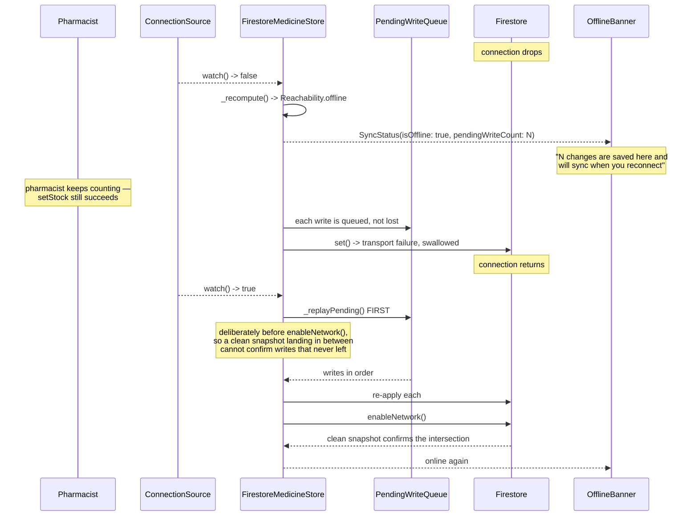

# PharmaGuide — Architecture Map

A pharmacy companion app for a counter terminal. It carries a per-account price
list, takes shelf stock counts and expiry dates, builds and completes sales,
preserves an in-progress order across restarts, and reads a printed prescription
with the camera.

- **Framework:** Flutter, `provider` for state, `go_router` for navigation.
- **Backend:** Firebase Auth for identity, Cloud Firestore for data.
- **Money:** Philippine pesos, stored as an integer number of **centavos**
  everywhere. No float ever holds a price.
- **Offline:** first-class. The app is expected to keep working when the network
  is gone, and to reconcile later.

The point of this document is to let a reader answer "where does this live, and
what touches it" without reading all of `lib/`. It ends with the known gaps,
because a map that only flatters the code is not worth much.

---

## 1. Directory map

```
lib/
  main.dart                  Composition root: provider graph, splash gate
  app.dart                   MaterialApp.router, theme wiring
  firebase_options.dart      Generated by flutterfire

  bootstrap/
    firebase_bootstrap.dart  initializeApp + Firestore disk cache; never throws
    splash_screen.dart       Branded splash shown while the above resolves
    bootstrap_failure_screen.dart  Readable failure when Firebase won't start

  core/
    navigation/app_shell.dart  Bottom NavigationBar over the shell branches
    theme/app_theme.dart       Light + dark ThemeData
    connectivity/connection_source.dart  OS-level "is there a network" answer
    lifecycle/disposable_store.dart      dispose() contract, tolerate twice
    utils/currency.dart        formatCentavos
    widgets/
      offline_banner.dart     Connection loss, driven by SyncStatus
      offline_mode_banner.dart Deliberate offline mode, driven by AuthProvider
      feature_placeholder.dart  UNUSED

  routing/
    app_router.dart           GoRouter, auth redirect, four shell branches

  features/
    auth/       sign in, sign up, Google, deliberate offline mode
    search/     the price list: model, stores, offline sync, provider, row UI
    dashboard/  Home tab, Inventory tab, Expiring meds
    orders/     order draft + order history, two providers
    sales/      the new-sale screen
    reports/    sales / low stock / expiry reporting
    scan/       camera -> ML Kit OCR -> catalogue matching
    profile/    profile screen; settings screen (UNUSED)

assets/
  data/medicines_seed.json    490 price-list lines, bundled
  data/sales_seed.json        2043 historical sale lines, bundled
  data/medicines_seed.json.bak   stale backup of the above, unregistered
  fonts/PlayfairDisplay-Variable.ttf
  images/baseIcon.png, bgtheme.jpg

tool/
  import_sales_tracker.dart   985-line importer: xlsx -> the two seed JSONs
  seed_firestore.dart         optional manual upload of the seed
  out/                        generated review artefacts (checked in)

test/                         19 test files + 5 shared fakes in helpers/
integration_test/             EMPTY (package still declared as a dev dep)

firestore.rules               deployed by hand, deliberately not in build path
Daily Sales Tracker.xlsx      the source of truth for the bundled price list
```

### Feature layout

Every feature follows the same three-layer shape, so `presentation/` never
imports `cloud_firestore` directly:

```
features/<name>/
  data/
    models/         plain Dart, no Flutter import
    repositories/   interfaces + implementations
    sync/           (search only) pending writes and status
  presentation/
    providers/      ChangeNotifiers
    screens/        one file per screen
    widgets/        reusable pieces
```

---

## 2. Layer and feature map

Dependencies point downward. `presentation` knows about repositories;
repositories know about Firestore and preferences; nothing in `data/` imports
`provider`.



### Features at a glance

| Feature | Provider | Screens | Backing store |
|---|---|---|---|
| auth | `AuthProvider` | `AuthLandingScreen` | Firebase Auth + `OfflineSession` |
| search | `MedicineProvider` | (no screen; feeds Home/Inventory/Reports) | `SeededMedicineStore` → `FirestoreMedicineStore` or `LocalMedicineStore` |
| dashboard | — | `DashboardScreen`, `InventoryScreen`, `ExpiringMedsScreen` | reads `MedicineProvider` + `OrderProvider` |
| orders | `OrderProvider`, `OrdersProvider` | `OrdersScreen` | `OrderDraftStore`, `OrderHistoryRepository` |
| sales | — | `NewSaleScreen` | writes through `OrderProvider` |
| reports | `ReportsProvider` | `ReportsScreen` | `ReportsRepositoryImpl` |
| scan | — | `ScanScreen` | `PrescriptionCamera`, `PrescriptionRecognizer`, `PrescriptionMatcher` |
| profile | — | `ProfileScreen`, `SettingsScreen` (unused) | reads `AuthProvider` |

Note that only three features own providers. The dashboard and sales features
are views over other features' state, which is why they have no provider of
their own.

---

## 3. Composition root and startup

Everything is wired in one place, `lib/main.dart:106`. Two of the providers are
built by a **factory keyed on uid** rather than by a store instance, because the
store has to be different for a different account.

```dart
ChangeNotifierProvider<MedicineProvider>(
  create: (ctx) => MedicineProvider(
    auth: ctx.read<AuthProvider>(),
    storeFor: (uid) => uid == AuthProvider.offlineUserId
        ? LocalMedicineStore()
        : SeededMedicineStore(remote: FirestoreMedicineStore(...)),
  ),
)
```

Both `MedicineProvider` and `OrderProvider` sit **above** the router, so the
price list and the open basket survive a tab switch. `OrderProvider`'s draft
store additionally outlives the process closing.

### Startup sequence



Two decisions worth naming:

- **The 700 ms floor** (`main.dart:54`). Firebase usually initialises in under
  100 ms, which reads as a flash rather than a splash.
- **`await auth.ready` in the redirect** (`app_router.dart:57`). The router is
  built as soon as the graph is, so on a cold start the auth status genuinely is
  still unknown. Without the await, login paints for one frame and then bounces a
  signed-in user onward.

---

## 4. Navigation

`StatefulShellRoute.indexedStack` with four branches. Each branch keeps its own
navigator, so a tab's stack and scroll position survive a round trip to another
tab.



- There is **no `/` route.** The signed-in area is the shell, and each branch owns
  its own path, so the app starts on branch 0 directly.
- `expiring`, `scan` and `profile` are nested children of Home rather than tabs,
  so the bottom bar keeps Home selected and the back arrow has somewhere to go.
- **The branch order in `app_router.dart` and `AppShell.destinations` must match.**
  `navigationShell.goBranch` takes an index, not a route name. This is the one
  silent-failure coupling in the app, and `test/nav_alignment_test.dart` exists
  specifically to walk every index and break it loudly if it drifts.

The redirect in `app_router.dart:49` resolves the four auth statuses:

| `AuthStatus` | At `/login`? | Result |
|---|---|---|
| `unknown` | — | wait on `auth.ready` first |
| `unauthenticated` | yes | stay |
| `unauthenticated` | no | → `/login` |
| `authenticated` | yes | → `/home` |
| `authenticated` | no | stay |
| `offline` | yes | → `/home` |
| `offline` | no | stay |

---

## 5. Data model

### The price-list line

`MedicineModel` (`lib/features/search/data/models/medicine_model.dart`) is the
central model. Two of its choices propagate everywhere:

1. **`stock` is nullable, and `null` is not zero.** `null` means "never counted".
   A zero count means "counted, and there is none". `StockState` is four-valued
   for exactly this reason: `unknown`, `outOfStock`, `low`, `available`. The
   Inventory tab opens on the "Not counted" filter for the same reason.
2. **`==` is on `(name, priceCentavos)` only.** Stock, expiry, aliases and
   `genericKey` are excluded, so a line keeps its identity when the pharmacist
   edits it.

`documentId` is an FNV-1a hash of `'$name|$priceCentavos'` rendered as 8 hex
chars. Because the price is in the hash, the same product at a new price is a new
line, and re-importing the spreadsheet updates existing lines in place instead of
duplicating them.

### Firestore schema

Every path is rooted at `users/{uid}`. `uid` is the Firebase Auth uid, or the
literal `'offline'` (`AuthProvider.offlineUserId`) — though the offline pseudo-user
never reaches Firestore, because offline mode substitutes local stores.

**`users/{uid}/medicines/{medicineId}`** — the price list

| Field | Type | Notes |
|---|---|---|
| `name` | string | 1–60 chars, enforced by rules |
| `priceCentavos` | int | ≥ 0 |
| `stock` | int or null | `null` = uncounted |
| `expiryDate` | string or null | `yyyy-MM-dd`, deliberately **not** a `Timestamp` |
| `aliases` | list of string | alternative spellings, for OCR matching |
| `genericKey` | string or null | the generic the brand belongs to |
| `updatedAt` | `serverTimestamp` | added on every write |

Read as `orderBy('name').snapshots()`. There is **no `where(...)` anywhere in the
app.** Writes are `set(..., merge: true)`, so `setStock` sends only
`{'stock': …}` and cannot clobber a price or expiry from a stale widget copy.

**`users/{uid}/drafts/order`** — the in-progress basket, a single document

| Field | Type | Notes |
|---|---|---|
| `lines` | list of map | `{'name', 'priceCentavos', 'quantity'}` — identity only |
| `revision` | int | monotonic per-device counter |
| `updatedAt` | `serverTimestamp` | |

`OrderLineCodec` deliberately stores no `stock`; it is reconstructed as `null` on
read, since a basket line is a price quote rather than a shelf claim.

**`users/{uid}/orders/{orderId}`** — order history

| Field | Type | Notes |
|---|---|---|
| `time` | `Timestamp` | also the `orderBy` key |
| `status` | string | `'new'` or `'approved'` |
| `lines` | list of map | same shape as the draft |
| `totalCentavos` | int | |
| `createdAt` | `serverTimestamp` | |

`orderId` is `DateTime.now().millisecondsSinceEpoch.toString()`.

### Bundled and local storage

| Where | Key | Contents |
|---|---|---|
| SharedPreferences | `offlineMode` | `'active'` or `''` |
| SharedPreferences | `pendingWrites/$uid` | `{version, nextId, writes[]}` — namespaced by uid |
| SharedPreferences | `offlineMedicinesOverlay` | `{documentId: {stock, expiryDate}}`, changed fields only |
| SharedPreferences | `offlineOrderDraft` | `{lines, revision}` |
| asset | `assets/data/medicines_seed.json` | 490 lines; **all** have `stock: null` |
| asset | `assets/data/sales_seed.json` | 2043 sale lines, 2025-07-12 .. 2025-09-29 |

The uid namespace on `pendingWrites/$uid` is deliberate: a shared counter tablet
is signed in and out all day, and one pharmacist's unsent stock counts must not
surface as another's.

Firestore's disk cache is the third layer and is switched on explicitly at
`firebase_bootstrap.dart:62` — `persistenceEnabled: true`, 16 MB. The rest of the
offline story rests on that one setting, so it is stated out loud rather than left
to an SDK default.

---

## 6. Offline sync

This is the most intricate part of the app. There are **three** independent
durability layers:

1. Firestore's own persisted write queue (disk cache).
2. `PendingWriteQueue` — the app's own second copy, in SharedPreferences.
3. `LocalMedicineStore`'s overlay patch map, for deliberate offline mode.

Layer 2 exists for the cases layer 1 does not cover: the app killed mid-queue, or
the native cache evicted under its LRU budget.

### A stock count, happy path



That intersection is the whole trick. A write that is queued but never put on the
wire cannot be marked confirmed by a clean snapshot, so a stock count taken
offline is not silently lost when the connection returns.

### Losing and regaining the connection



Two details that are easy to get wrong:

- **Order matters on reconnect.** `_replayPending()` runs *before*
  `firestore.enableNetwork()`. Reversed, a server snapshot arriving in between
  would confirm writes that had not been re-sent.
- **Transport failures are not user errors.** `_submit` swallows them and leaves
  the write queued; the caller never hears. Only a *refused* write rethrows, and
  then the provider rolls the optimistic value back to `previous` and sets
  `error`. `isTransportFailure` deliberately excludes `PERMISSION_DENIED` and a
  missing database, because the connection coming back will not fix those.

`SyncStatus` carries `(reachability, pendingWriteCount, lastServerReadTime)`.
`pendingWriteCount` is explicitly a **lower bound**. `lastServerReadTime` is the
device clock, stamped when a non-cached snapshot arrives — the Dart client does
not carry Firestore's own server read time.

`_resolveReachability` gives Firestore the last word over the OS signal, because
Firestore has actually spoken to the server. `_platformConnected` starts as
`null`, never `false`, so no banner flashes at launch.

### Two kinds of offline

| | Deliberate offline mode | Lost connection |
|---|---|---|
| Entered by | "Continue offline" on the login screen | the network going away |
| Identity | `AuthProvider.offlineUserId == 'offline'` | unchanged |
| Price list | `LocalMedicineStore` | `FirestoreMedicineStore` + its disk cache |
| Basket | `LocalOrderDraftStore` | `FirestoreOrderDraftStore` |
| History | `LocalOrderHistoryRepository`, in memory only | Firestore |
| Banner | `OfflineModeBanner`, always on | `OfflineBanner`, on `status.isOffline` |
| Sync status | `SyncStatus.localOnly` | real, with a pending count |

In offline mode `SeededMedicineStore` reports `localOnly`, so the *connection*
banner stays hidden and the mode banner shows instead — the two never stack.

Order drafts use a **different, simpler model** than stock counts. The whole
basket is written through `OrderDraftStore.save()` on every change, entirely
outside `PendingWriteQueue`: no per-field merging, no confirmation tracking, no
rollback. It leans on Firestore's disk cache plus a `revision`/`_lastWritten` pair
in `_accept` to discard stale snapshots.

---

## 7. Reports

`ReportsRepositoryImpl` is the odd one out. `getLowStockAlerts()` and
`getExpiryAlerts()` walk the real catalogue from `MedicineProvider`, but
`getSalesReport()` calls `_generateSampleOrders`, which **fabricates** orders
with `math.Random(42)` (`reports_repository_impl.dart:135`). Categories are
guessed by `_inferCategory` keyword matching, and profit is a flat
`_defaultProfitMargin = 0.22`.

The real historical data does exist — `assets/data/sales_seed.json`, rebuilt from
the workbook by `tool/import_sales_tracker.dart`, and parsed properly by
`SalesRepository` / `SaleModel`. But `SalesRepository` is referenced only from
`test/reports_test.dart`. The running Reports tab never reads it. See gap G2.

---

## 8. Tests

19 test files under `test/`, plus five shared fakes in `test/helpers/`.

| File | Covers |
|---|---|
| `widget_test.dart` | auth provider units, routing, app bar titles, login sheet |
| `dashboard_search_test.dart` | Home search, quantity sheet, stock-line wording |
| `medicine_catalog_test.dart` | `StaticMedicineRepository`, search semantics |
| `medicine_persistence_test.dart` | `documentId` stability, Firestore round trip, `copyWith` |
| `medicine_provider_test.dart` | account scoping, optimistic writes and rollback |
| `seeded_medicine_store_test.dart` | bundle/server merge, auto-seed, disposal |
| `order_provider_test.dart` | basket arithmetic, stock caps, sign-out behaviour |
| `orders_screen_test.dart` | order tabs, approve action, empty states |
| `new_sale_screen_test.dart` | cart, payment selection, completing a sale |
| `offline_mode_test.dart` | offline session, both local stores, `OrderLineCodec` |
| `offline_banner_test.dart` | `OfflineBanner` copy per status, singular/plural, safe-vs-pending |
| `pending_write_queue_test.dart` | both queue implementations: durability, id reuse, ceiling, unreadable storage |
| `connection_source_test.dart` | `PlatformConnectionSource` against a fake `ConnectivityPlatform` |
| `reports_test.dart` | report arithmetic against `SaleModel` |
| `prescription_matcher_test.dart` | OCR-to-catalogue ranking, including misreads |
| `scan_screen_test.dart` | camera gate, reading, suggestions, disposal |
| `mlkit_text_recognizer_test.dart` | plugin channel mapping and failure modes |
| `nav_alignment_test.dart` | bar/branch order and label fit on a 360 dp phone |
| `splash_test.dart` | splash artwork, bootstrap gating |

### Injection seams

Only three screens and one widget take constructor parameters for tests:

| Seam | Type | Purpose |
|---|---|---|
| `PharmaGuideApp.bootstrap` | `Future<FirebaseBootstrapResult>?` | control when the splash gives way |
| `OrdersScreen.historyFactory` | `OrderHistoryRepository Function()?` | inject order history |
| `ReportsScreen.repository` | `ReportsRepository?` | inject report data |
| `ScanScreen.{repository, recognizer, camera}` | interface types | inject catalogue, OCR, camera |

`AuthLandingScreen`, `DashboardScreen`, `InventoryScreen`, `ExpiringMedsScreen`,
`NewSaleScreen` and `ProfileScreen` have no seam; their tests build a provider
graph around them instead.

### Shared fakes

| Fake | Interface |
|---|---|
| `FakeAuthRepository` | `AuthRepository` — counters, injectable failures, a gateable refresh |
| `FakeMedicineStore` | `MedicineStore` — `operations` log, injectable read/write errors |
| `FakeSyncingMedicineStore` | adds `SyncStatusSource`, kept separate so a store that does *not* report reachability stays provable |
| `FakePrescriptionCamera` | `PrescriptionCamera` — support flags, picture bytes, disposal flag |
| `FakePrescriptionRecognizer` | `PrescriptionRecognizer` — readings, gateable `recognize`, disposal flag |

`integration_test/` is empty but the package is still a dev dependency. The Scan
integration test was deleted and is tracked as deferred item **D1** in `WORKTODO`
— camera and OCR need a physical device.

---

## 9. Tooling

`Daily Sales Tracker.xlsx` at the repo root is the source of truth for both the
bundled price list and the historical sales data.

**`tool/import_sales_tracker.dart`** (985 lines) reads the workbook with
`package:excel`, skips four sheets, tags `STEVEN ORDER` and `TITA RITA` as bulk,
and derives dates from sheet names against a hard-coded `salesYear = 2025`. It
merges misspelled duplicates using a conservative rule — at most two edits,
matching digit signature, and never merging two distinct product names — and
writes eight files:

| Output | Purpose |
|---|---|
| `assets/data/medicines_seed.json` | ships in the app |
| `assets/data/sales_seed.json` | ships in the app |
| `tool/out/medicines_seed.json`, `tool/out/sales_seed.json` | byte-identical copies |
| `tool/out/merge_review.csv` | `applied,units,canonical,members,reason` — every merge for audit |
| `tool/out/junk_candidates.json` | rows that looked like products but were dropped |
| `tool/out/excluded_sources.json` | sheet name → `{reason, rows}` |
| `tool/out/fractional_quantity.json` | the two half-tablet lines, kept unrounded |

**`tool/seed_firestore.dart`** (66 lines) uploads the medicine seed to
`users/{uid}/medicines` in 500-write batches. It is now optional: a brand-new
account self-seeds from the bundle via `SeededMedicineStore._seedIfEmpty`.

---

## 10. Known gaps

Real inconsistencies found while reading, each with a reference. None are
speculation; the caveat on G1 is noted inline.

**G1 — FIXED: `firestore.rules` did not cover two collections the app writes.**
`users/{uid}/drafts/order` and `users/{uid}/orders/{orderId}` had no `match`
block, so they fell through to the `if false` catch-all and both were
unwritable and unreadable. Rules added for both, checked field by field against
what `OrderLineCodec` and `FirestoreOrderHistoryRepository` actually write:
`validDraft`, `validOrder`, `validOrderLines`, `validOrderLine`, `validStatus`.

Two decisions in that fix worth knowing about:

- `validOrder` checks `request.resource.data`, which on an update is the **whole
  resulting document**, not the incoming patch. `updateStatus` sends only
  `status`, and a completeness check on the patch alone would reject it.
- Order-line `quantity` is an `int` here but a `number` in `validSale`. A counter
  order is whole items; the half-tablet lines are the bulk workbook's shape.

Still not deployed — see G9.

**G2 — FIXED: the Reports tab reads real sales data.** `getSalesReport()` now
builds its figures from the accepted orders in the order-history repository
(`historyFactory().watchAll()`), filtered to approved orders within the range,
instead of `math.Random`. `getLowStockAlerts()` and `getExpiryAlerts()` read the
live catalogue. `math.Random` no longer appears anywhere in `lib/`. The one
number that is still an assumption is profit: the price list has no cost price,
so profit is reported as revenue times `assumedProfitMargin` (22%) and the
screen states that beside the metric.

**G3 — FIXED: the three zero-call-site widgets are deleted.** `SettingsScreen`
(no route, no test), `DashboardTile` and `FeaturePlaceholder` were removed.
`OrdersProvider` was also reduced to its one live method, `updateOrderStatus`;
the tab state, `initialize`/`_loadOrders` and `OrderTab` enum it carried were
read by nothing (the Orders screen subscribes to the repository directly).

**G4 — FIXED: order history is live.** The Orders screen reads the repository
through a `StreamBuilder`, so it reacts to changes as they land. The old
`OrdersProvider._loadOrders` that took a single `watchAll().first` sample was
dead code and has been deleted along with the rest of that provider's unused
state.

**G5 — FIXED: `ReportsProvider` notifies on every error.** The leaf loaders set
their error through `_handleError`, which calls `notifyListeners()`, and
`_setLoading` notifies on the loading transitions. Covered by
`test/reports_provider_test.dart` (10 tests).

**G6 — PARTLY FIXED: the sync layer had no tests.** `PendingWriteQueue` (both
implementations) and `ConnectionSource` are now covered, in
`test/pending_write_queue_test.dart` (28 tests) and
`test/connection_source_test.dart` (11 tests): the queue's version-mismatch
handling, 500-entry cap, id-reuse protection and unreadable-storage paths; and
the rule that only `ConnectivityResult.none` may mean "no route".

Two things the new tests found:

- **A real bug in `PlatformConnectionSource`, now fixed.** `onCancel` cancels the
  platform subscription, so while nothing is listening the source goes deaf. A
  later listener re-ran `onListen`, found the refresh unchanged, and — because
  `_publish` declines to repeat an unchanged value — never received the current
  answer at all. It waited on a stream carrying only changes. `watch()` now hands
  the held answer to whoever subscribes, before refreshing.
- `test/offline_banner_test.dart` asserted the copy `'Changes are saved'`, which
  the banner has never used; it renders `1 change is saved here` / `N changes are
  saved here`. That test had been failing. Corrected, and it now covers the
  singular/plural split and the icon that distinguishes "safe" from "not yet".

**Still untested: `FirestoreMedicineStore` itself**, which owns the confirmation
intersection and the replay-before-`enableNetwork` ordering — the two most
subtle things in the codebase. Covering it needs a Firestore emulator or a
`fake_cloud_firestore` dependency; neither is set up here. That is the remaining
half of this gap and worth doing next.

**G7 — FIXED: `README.md` now describes the app that exists.** It previously
said signing in landed on a placeholder and documented a `lib/` layout
containing only `features/auth`. It now lists the real workspaces (staff shell
and admin), the feature directory layout and the reports profit caveat.

**G8 — Stray `assets/data/medicines_seed.json.bak`.** Byte-identical to the live
asset and not registered in `pubspec.yaml`.

**G9 — `firebase.json` has no `firestore` section**, so `firebase deploy` will not
deploy `firestore.rules` without one being added. This appears deliberate, and
matches the rules file's own header.

**G10 — Inert "coming soon" controls.** Several rows and buttons are affordances
with no implementation behind them; each shows a snackbar. They span
`InventoryScreen` (bulk count entry), `ExpiringMedsScreen` (expiry
notifications, batch expiry entry, export list), `AdminHomeScreen` (store
settings, activity log) and `ProfileScreen` (store details, permissions, help
and support, about). There is still no PDF, printing, sharing or CSV code
anywhere in the app: no `pdf`, `printing`, `share_plus` or `path_provider`
dependency, and the only file writes in `lib/` are two temp JPEGs in the scan
feature, because the ML Kit plugin takes a path rather than bytes. The Reports
screen no longer carries an export button.